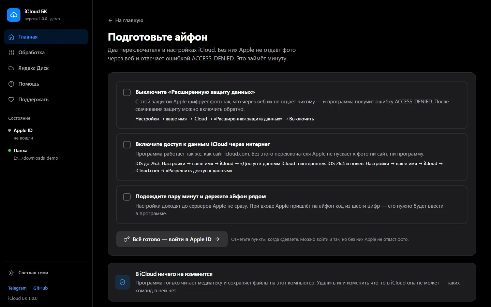
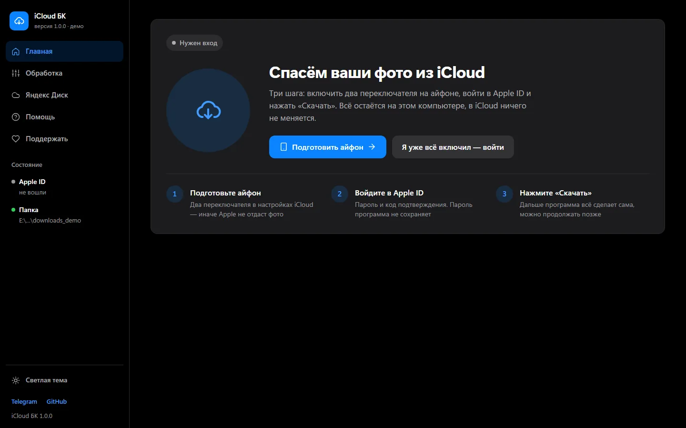
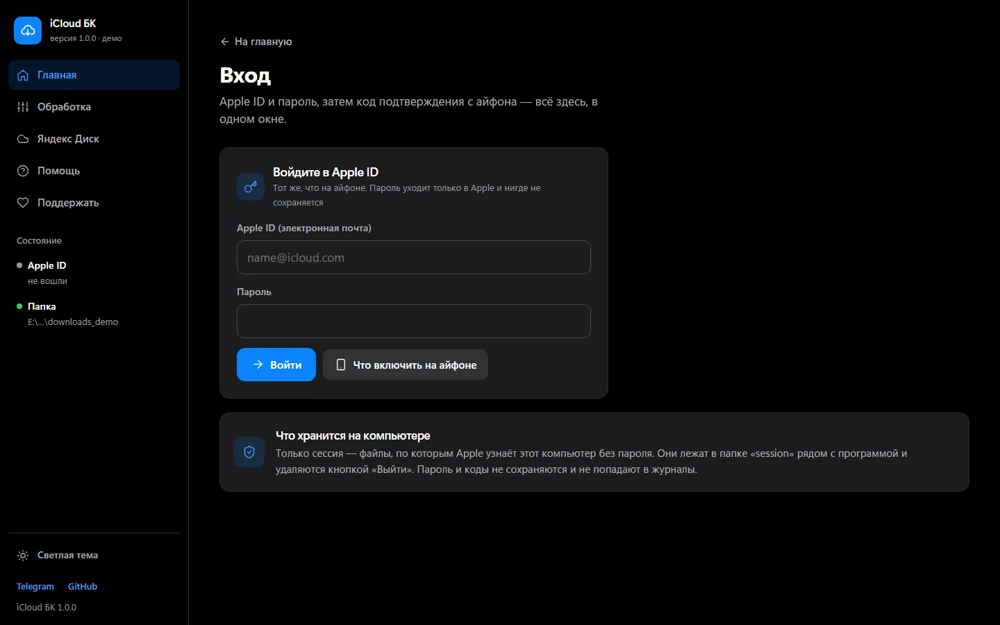
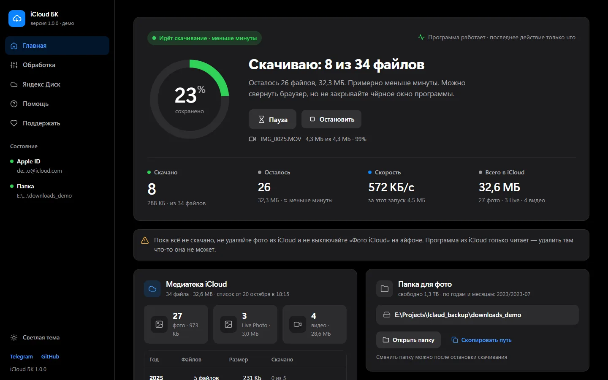
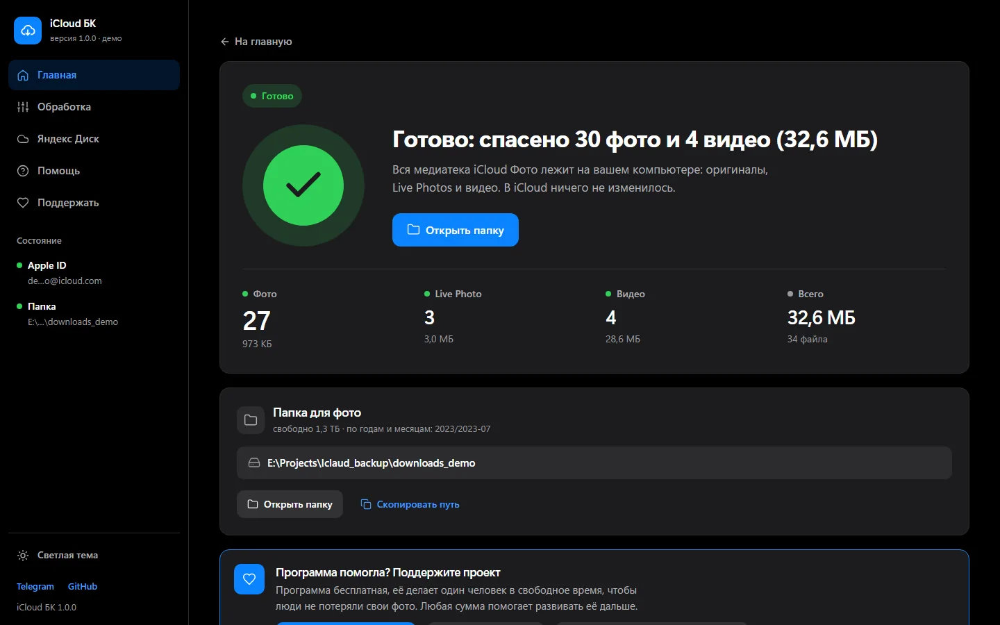
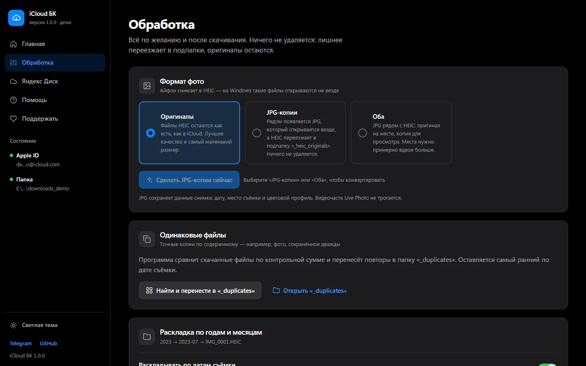

<!--
  Этот файл удобнее читать в браузере, а не в Блокноте:
  https://github.com/PXSYS13/icloud_backup/blob/main/INSTRUCTION.md
-->
# Пошаговая инструкция: как сохранить все фото из iCloud на компьютер

Для тех, кто делает такое впервые. Один шаг — одно действие. Настройка займёт 10–15 минут, дальше программа качает сама.

> [!NOTE]
> Пароль от Apple ID программа не сохраняет: он нужен один раз, чтобы войти, и уходит только в Apple. На компьютере остаётся сессия — данные входа, которые выдала Apple. Программа только читает iCloud: удалить или изменить там что-то она не может.

> [!IMPORTANT]
> **Программа в тестовом режиме.** Она только что вышла, и на настоящих медиатеках её проверили немногие. Если вы дошли до конца или застряли на каком-то шаге — [расскажите, как прошло](#тестовый-режим-расскажите-как-прошло). Это займёт пять минут и поможет следующим людям.

## Содержание

1. [Что понадобится](#что-понадобится)
2. [Шаг 1. Подготовьте айфон](#шаг-1-подготовьте-айфон)
3. [Шаг 2. Скачайте программу](#шаг-2-скачайте-программу)
4. [Шаг 3. Распакуйте архив](#шаг-3-распакуйте-архив)
5. [Шаг 4. Запустите программу](#шаг-4-запустите-программу): [Windows](#на-windows), [macOS](#на-macos), [Linux](#на-linux)
6. [Шаг 5. Войдите в Apple ID](#шаг-5-войдите-в-apple-id)
7. [Шаг 6. Выберите папку для фото](#шаг-6-выберите-папку-для-фото)
8. [Шаг 7. Проверьте медиатеку и скачайте всё](#шаг-7-проверьте-медиатеку-и-скачайте-всё)
9. [Где мои файлы и что дальше](#где-мои-файлы-и-что-дальше)
10. [Обработка и копия в Яндекс Диск](#обработка-и-копия-в-яндекс-диск)
11. [Если что-то пошло не так](#если-что-то-пошло-не-так)
12. [Как обновить программу](#как-обновить-программу)
13. [Как выйти из Apple ID](#как-выйти-из-apple-id)
14. [Тестовый режим: расскажите, как прошло](#тестовый-режим-расскажите-как-прошло)
15. [Помощь](#помощь)
16. [Поддержать проект](#поддержать-проект)

---

## Что понадобится

- Компьютер с Windows 10 или 11, macOS или Linux, и интернет.
- Айфон, на котором выполнен вход в нужный Apple ID. Держите его рядом: при входе Apple пришлёт на него код из шести цифр.
- Пароль от Apple ID.
- Свободное место на диске: примерно столько, сколько занимает медиатека. Точную цифру программа покажет на шаге 7.
- Ставить Python или что-то ещё вручную **не нужно**: всё нужное программа скачает сама.

Подписка iCloud+ закончилась или хранилище переполнено? Это не мешает: то, что уже лежит в iCloud, можно скачать. Лучше не откладывать.

---

## Шаг 1. Подготовьте айфон

Это обязательный шаг. Без него Apple отвечает ошибкой **ACCESS_DENIED** и не даёт программе доступ к фото.

1. **Выключите «Расширенную защиту данных»**, если она включена: «Настройки» → ваше имя → iCloud → «Расширенная защита данных» → «Выключить». Фото при этом не удаляются. Когда всё скачается, защиту можно включить обратно.
2. **Включите доступ к данным iCloud через интернет:**
   - iOS до 26.3 включительно: «Настройки» → ваше имя → iCloud → включите **«Доступ к данным iCloud в интернете»**;
   - iOS 26.4 и новее: «Настройки» → ваше имя → iCloud → iCloud.com → включите **«Разрешить доступ к данным»**.
3. Подождите несколько минут: настройки доходят до серверов Apple не сразу.

Порядок важен: пока включена «Расширенная защита данных», Apple сама выключает доступ через интернет.

Версию iOS можно посмотреть в «Настройки» → «Основные» → «Об этом устройстве».

Ещё два условия, они почти всегда уже выполнены:

- у Apple ID включена двухфакторная проверка (код на айфон при входе);
- вход по коду, а не по аппаратному ключу безопасности (FIDO). С такими ключами программа работать не может.

---

## Шаг 2. Скачайте программу

1. Нажмите ссылку: **[скачать программу (ZIP-архив)](https://github.com/PXSYS13/icloud_backup/archive/refs/heads/main.zip)**.
2. Браузер сохранит файл **icloud_backup-main.zip** в папку «Загрузки».

Это архив, внутри — папка с программой. В систему ничего не устанавливается.

---

## Шаг 3. Распакуйте архив

**Windows:**

1. Откройте папку «Загрузки».
2. Щёлкните правой кнопкой мыши по файлу **icloud_backup-main.zip** и выберите **«Извлечь всё…»**, затем **«Извлечь»**.
3. Откроется новая папка **icloud_backup-main**. Дальше работайте с ней.

> [!WARNING]
> Не запускайте программу прямо из ZIP-архива: Windows разрешает открыть архив как папку, но тогда программа не сможет сохранить настройки и вход. Сначала «Извлечь всё».

**macOS:** Safari обычно распаковывает архив сам, и в «Загрузках» появляется папка **icloud_backup-main**. Если там лежит только ZIP-файл, дважды кликните по нему.

**Linux:** щёлкните правой кнопкой по архиву и выберите «Извлечь сюда».

Папку можно переложить куда удобно, например на Рабочий стол. Файлы внутри не переименовывайте.

---

## Шаг 4. Запустите программу

### На Windows

1. Откройте папку **icloud_backup-main**.
2. Дважды кликните по файлу **webui.bat**. Если окончания файлов у вас скрыты, файл называется просто **webui**, тип — «Пакетный файл Windows».
3. Если появилось синее окно **«Windows защитил ваш компьютер»**, нажмите **«Подробнее»**, затем **«Выполнить в любом случае»**. Если окно **«Предупреждение системы безопасности»**, нажмите **«Запустить»**. Программа бесплатная, с открытым кодом; Windows просто не знает её автора.
4. Откроется чёрное окно. В первый раз в нём побегут строчки на английском: программа скачивает всё нужное. Это занимает 1–2 минуты.
5. Потом сам откроется браузер со страницей программы.

### На macOS

1. Откройте папку **icloud_backup-main** в Finder.
2. Дважды кликните по файлу **webui.command**. Откроется окно Терминала, программа сама всё установит (1–2 минуты в первый раз) и откроет браузер.
3. Если macOS пишет, что не может открыть файл, потому что не удалось проверить разработчика: откройте **Системные настройки → Конфиденциальность и безопасность**, пролистайте вниз и нажмите **«Всё равно открыть»** рядом с `webui.command`. На старых версиях macOS вместо этого щёлкните по файлу правой кнопкой (или с зажатой <kbd>Control</kbd>), выберите **«Открыть»** и ещё раз **«Открыть»**.
4. Если двойной клик так и не сработал, есть запасной способ:
   - откройте Терминал: нажмите <kbd>Cmd</kbd> + <kbd>Пробел</kbd>, наберите **Терминал**, нажмите <kbd>Enter</kbd>;
   - напечатайте `bash` и **пробел**; Enter пока не нажимайте;
   - перетащите мышкой файл **webui.sh** из Finder в окно Терминала, путь к нему подставится сам;
   - нажмите <kbd>Enter</kbd>.

### На Linux

1. Откройте папку **icloud_backup-main** в файловом менеджере.
2. Щёлкните правой кнопкой по пустому месту в папке и выберите **«Открыть в терминале»**.
3. Напечатайте `bash webui.sh` и нажмите <kbd>Enter</kbd>.

Если пункта «Открыть в терминале» нет: откройте Терминал (<kbd>Ctrl</kbd> + <kbd>Alt</kbd> + <kbd>T</kbd>), напечатайте `bash` и пробел, перетащите в окно файл **webui.sh** и нажмите <kbd>Enter</kbd>.

### Что важно знать про чёрное окно

- Это окно и есть программа. **Пока оно открыто, программа работает.** Закрыли окно — скачивание остановилось. Уже скачанное при этом не пропадает.
- Страница в браузере с адресом **localhost:8000** — это пульт управления программой на вашем компьютере. В интернет она не выкладывается, другие люди её не видят. Браузер можно закрыть и открыть снова — скачивание от этого не прервётся.
- Если браузер не открылся сам, откройте любой браузер и наберите в адресной строке адрес из строки «Адрес» в чёрном окне — обычно **localhost:8000**. Если этот адрес занят другой программой, программа возьмёт следующий — например, **localhost:8001** — и напишет об этом в окне.
- В следующий раз запускайте программу так же: двойной клик по тому же файлу. Повторная установка уже не нужна, старт займёт секунды.

---

## Шаг 5. Войдите в Apple ID

1. На «Главной» нажмите **«Подготовить айфон»**. Программа ещё раз покажет переключатели из шага 1. Отметьте пункты и нажмите **«Всё готово — войти в Apple ID»**.
2. Введите **Apple ID** (электронную почту, как на айфоне) и **пароль**. Нажмите **«Войти»**.
3. Apple пришлёт на айфон код из шести цифр. Если на айфоне сначала появится вопрос **«Разрешить вход?»** — нажмите **«Разрешить»**, цифры появятся следом.
4. Введите код в поле **«Шесть цифр с айфона»** и нажмите **«Подтвердить»**.
5. Программа напишет **«Вы вошли»**. Нажмите **«К скачиванию»**.

Код не пришёл? Подождите минуту. Потом попросите код вручную: на айфоне «Настройки» → ваше имя → «Пароль и безопасность» → «Получить код подтверждения». Код приходит и на другие ваши устройства Apple — проверьте айпад или мак.

Вход сохраняется на этом компьютере: при следующем запуске вводить пароль и код не нужно. Apple обычно держит вход около двух месяцев, иногда меньше.

> [!WARNING]
> Никому не пересылайте пароль от Apple ID и коды подтверждения — даже автору программы. Для помощи они не нужны.

---

## Шаг 6. Выберите папку для фото

На «Главной» есть карточка **«Папка для фото»**: там путь, куда лягут файлы, и сколько на этом диске свободно.

1. Если не знаете, что выбрать, можно оставить как есть: файлы лягут в папку `downloads` внутри папки программы. Но медиатека обычно большая, поэтому **лучше выбрать диск, где много места**, например внешний.
2. Чтобы сменить папку, нажмите **«Сменить папку»** и вставьте путь к папке:
   - **Windows:** откройте папку в Проводнике, щёлкните по адресной строке вверху окна, скопируйте <kbd>Ctrl</kbd> + <kbd>C</kbd> и вставьте в поле. Пример: `D:\iCloudBackup`;
   - **macOS:** выделите папку в Finder и нажмите <kbd>Option</kbd> + <kbd>Cmd</kbd> + <kbd>C</kbd>, путь скопируется. Пример: `/Users/ivan/iCloudBackup`.

   Если такой папки ещё нет, программа создаст её сама.
3. Нажмите **«Сохранить папку»**.

Нельзя выбрать корень диска (`C:\` или `E:\`), системные папки и папку пользователя целиком. Программа такой путь не примет и объяснит почему.

Если внешний диск в формате FAT32, программа предупредит: файлы больше 4 ГБ (длинные видео) на такой диск не запишутся. Для больших видео нужен NTFS или exFAT.

---

## Шаг 7. Проверьте медиатеку и скачайте всё

1. На «Главной» нажмите **«Проверить медиатеку»**. Программа получит от Apple список файлов: счётчик найденного растёт. Для большой медиатеки это займёт несколько минут.
2. Программа покажет, сколько в iCloud фото, Live Photos и видео и сколько места они займут, — по годам. Если места на диске не хватит, появится предупреждение **«Места на диске может не хватить»**: выберите другую папку (шаг 6).
3. Сверьте число с айфоном: приложение «Фото» → «Медиатека» → пролистайте в самый низ, там написано «N фото, M видео». Live Photo считается одним файлом; фото из «Недавно удалённых» и «Скрытых» программа не качает.
4. Нажмите **«Скачать всё»**.

Можно и сразу нажать **«Сразу скачать всё»** — список программа соберёт сама.

Что вы увидите:

- сколько уже **скачано**, скорость и сколько осталось по времени;
- имя файла, который качается сейчас, и справа — **последние скачанные**;
- кнопки **«Пауза»** и **«Остановить»**. После паузы или остановки нажмите **«Продолжить»** — скачанное второй раз качаться не будет.

Если Apple отвечает с перебоями или пропал интернет, программа сама ждёт и повторяет. Вверху «Главной» будет написано **«Жду Apple»** и время повтора — ничего делать не нужно.

Большая медиатека качается часами. Настройте компьютер, чтобы он не засыпал, а у ноутбука не закрывайте крышку. Если компьютер всё же уснул или выключился, скачанное не потеряется: запустите программу снова, если окно закрылось, и нажмите **«Продолжить»**.

Когда всё скачается, откроется экран **«Готово»**: сколько фото и видео сохранено и где они лежат.

---

## Где мои файлы и что дальше

- Файлы лежат в папке из шага 6, по годам и месяцам: например, `2023/2023-07/IMG_0001.HEIC`. У каждого файла дата изменения — дата съёмки, поэтому в проводнике их удобно сортировать по дате.
- **Открыть папку:** кнопка **«Открыть папку»** на «Главной» или на экране «Готово».
- **Live Photos** лежат двумя файлами рядом с одним именем: фото (`IMG_0001.HEIC` или `.JPG`) и его видеочасть (`IMG_0001.MOV`). Если загрузить их обратно на айфон, он снова соберёт живое фото.
- **Добавились новые фото в iCloud:** нажмите на «Главной» **«Проверить новые фото»**, потом **«Продолжить»**. Уже скачанное второй раз не качается.
- **Часть файлов не скачалась:** на «Главной» будет кнопка **«Повторить для N файлов»**.

> [!CAUTION]
> Прежде чем удалять что-то из iCloud, проверьте папку: откройте несколько фото и видео из разных лет. Удалять из iCloud или нет — решаете вы; программа сама там ничего не трогает.

---

## Обработка и копия в Яндекс Диск

Это необязательно. Всё ниже — после скачивания, в меню слева.

**Обработка:**

- **Формат фото.** По умолчанию «Оригиналы»: файлы HEIC остаются как есть. «JPG-копии» — рядом появится JPG, а HEIC переедет в подпапку `_heic_originals`. «Оба» — JPG рядом с HEIC. JPG сохраняет дату и место съёмки. Нужно, если HEIC не открываются на Windows.
- **Одинаковые файлы.** Точные копии переносятся в папку `_duplicates`, а не удаляются.
- **Раскладка по годам и месяцам.** Включена по умолчанию. Если выключить и нажать «Переложить уже скачанное», все файлы лягут в одну папку.

**Яндекс Диск:** программа может залить скачанное в папку «iCloud БК» на Диске, с теми же папками по годам. Для этого нужен ключ доступа (токен) — тот же, что в «Яндекс БК». Как его получить, рассказано в [инструкции «Яндекс БК», шаг 4](https://github.com/PXSYS13/yadisk_backup/blob/main/INSTRUCTION_GET_TOKEN.md#шаг-4-получите-токен). На экране «Яндекс Диск» нажмите **«Ввести ключ»**, вставьте его и нажмите **«Проверить и сохранить»**, потом **«Загрузить в Яндекс Диск»**.

> [!IMPORTANT]
> Загрузка через программу занимает обычное место на Диске. Безлимит для фото Яндекс даёт только автозагрузке из своего мобильного приложения.

---

## Если что-то пошло не так

| Что вы видите | Что это значит | Что делать |
|---|---|---|
| Чёрное окно открылось и сразу закрылось или пишет «Could not install uv automatically» | Не скачались нужные компоненты | Проверьте интернет и запустите снова. Не помогло — установите uv [по инструкции](https://docs.astral.sh/uv/getting-started/installation/) и запустите `webui.bat` ещё раз |
| «Windows защитил ваш компьютер» | Windows не знает автора программы | «Подробнее», затем «Выполнить в любом случае» |
| macOS: «не удаётся проверить разработчика» | macOS не знает автора программы | Системные настройки → Конфиденциальность и безопасность → «Всё равно открыть» |
| Браузер не открылся | Ничего страшного | Наберите в браузере адрес из строки «Адрес» в чёрном окне, обычно **localhost:8000** |
| «Программа не отвечает — окно программы закрыто?» | Чёрное окно закрыто, программа остановлена | Запустите программу снова (шаг 4) |
| «Apple не принял Apple ID или пароль» | Опечатка в Apple ID или пароле, или вход по ключу FIDO | Проверьте Apple ID и пароль. С ключом безопасности FIDO программа не работает |
| «Код не подошёл» | Код введён с ошибкой или устарел | Попросите новый код на айфоне и введите его снова |
| Код не приходит | Apple задержал код | Подождите минуту, затем «Настройки» → ваше имя → «Пароль и безопасность» → «Получить код подтверждения» |
| «Apple не даёт доступ к фото через веб (ACCESS_DENIED)» | На айфоне не готовы настройки | Повторите шаг 1, подождите несколько минут. Потом «Помощь» → «Выйти из Apple ID» и войдите снова |
| «Сессия Apple истекла» | Apple завершил вход: прошло время или сменили пароль | Нажмите «Войти снова». Скачивание продолжится с того же места |
| «Apple ещё индексирует медиатеку iCloud Фото» | Apple готовит медиатеку к выдаче | Подождите несколько минут и нажмите «Проверить медиатеку» снова |
| «Жду Apple», «Нет связи с серверами Apple», ответ 503 или «Apple просит обращаться реже» | Перебои у Apple или с интернетом | Ничего не делайте: программа подождёт и повторит сама |
| «Места на диске может не хватить» | На выбранном диске мало места | Выберите папку на другом диске (шаг 6) |
| Скачивание остановилось, кнопка «Я освободил место — продолжить» | Место на диске кончилось | Освободите место или смените папку и нажмите эту кнопку |
| «Повторить для N файлов» | Часть файлов не скачалась | Нажмите кнопку. Если файлы снова не скачались — пришлите отчёт для поддержки |
| Файлы HEIC не открываются на Windows | Windows без дополнений не показывает HEIC | «Обработка» → «JPG-копии» или «Оба». Или установите «Расширения для изображений HEIF» из Microsoft Store |

Не нашли свой случай — смотрите [«Помощь»](#помощь).

---

## Как обновить программу

1. Закройте чёрное окно программы.
2. Скачайте архив заново (шаг 2).
3. Распакуйте его туда же, где лежит старая папка **icloud_backup-main**: в окне «Извлечь» укажите ту же родительскую папку, например «Рабочий стол», и согласитесь заменить файлы.
4. Запустите программу как обычно (шаг 4).

Вход в Apple ID, выбранная папка и прогресс скачивания сохранятся: их нет в архиве, поэтому они не перезапишутся.

---

## Как выйти из Apple ID

В программе: «Помощь» → **«Выйти из Apple ID»** → **«Выйти»**. Программа удалит сессию с этого компьютера — файлы из папки `session/`. Скачанные фото останутся на месте.

---

## Тестовый режим: расскажите, как прошло

Программа только что вышла. Каждый отзыв помогает найти ошибки, которые на одном компьютере не видны. Расскажите, даже если всё прошло хорошо: «скачалось 12 000 фото на Windows 11, всё сошлось» — тоже ценный отзыв.

**Как прислать отзыв:**

1. В программе откройте «Помощь» → **«Скачать отчёт для поддержки»**. Сохранится ZIP-файл с журналами программы. В нём нет пароля, кодов и ключей, а Apple ID записан не полностью.
2. Откройте **[форму «Отчёт о тестировании»](https://github.com/PXSYS13/icloud_backup/issues/new?template=test-report.yml)** на GitHub. Нужен бесплатный аккаунт GitHub.
3. Ответьте на вопросы: какая система, дошли ли до конца, сошлось ли число фото с айфоном, что было непонятно.
4. Перетащите ZIP-отчёт в поле «Отчёт для поддержки» и нажмите **«Create»** (создать).

Нашли ошибку — используйте **[форму «Сообщить об ошибке»](https://github.com/PXSYS13/icloud_backup/issues/new?template=bug-report.yml)**.

Нет аккаунта на GitHub — напишите то же самое в [Telegram](https://t.me/davronsv).

> [!WARNING]
> Отзывы на GitHub видят все. Не пишите туда пароль, коды подтверждения и полный Apple ID и не прикладывайте личные фото. В отчёте для поддержки есть путь к папке с фото (в нём может быть имя пользователя компьютера) и имена файлов вроде `IMG_0001.HEIC`. Не хотите показывать это всем — пришлите отчёт в Telegram.

---

## Помощь

- **Telegram-канал:** [t.me/davronsv](https://t.me/davronsv) — новости и ответы на вопросы.
- **Вопросы на GitHub:** [обсуждения](https://github.com/PXSYS13/icloud_backup/discussions).
- **Ответы на частые вопросы** — в программе, раздел «Помощь», и в [README](README.md#частые-вопросы).
- **Если просите помощи**, приложите отчёт: в программе «Помощь» → **«Скачать отчёт для поддержки»**.

---

## Поддержать проект

Программа бесплатная, её делает один человек в свободное время, чтобы люди не потеряли свои фото. Если она помогла, поддержите её развитие любой суммой: **[dalink.to/davronsvv](https://dalink.to/davronsvv)**.

Помочь можно и без денег: поставьте звезду [репозиторию](https://github.com/PXSYS13/icloud_backup), расскажите о программе тем, у кого переполнен iCloud, или пришлите отчёт о тестировании.
